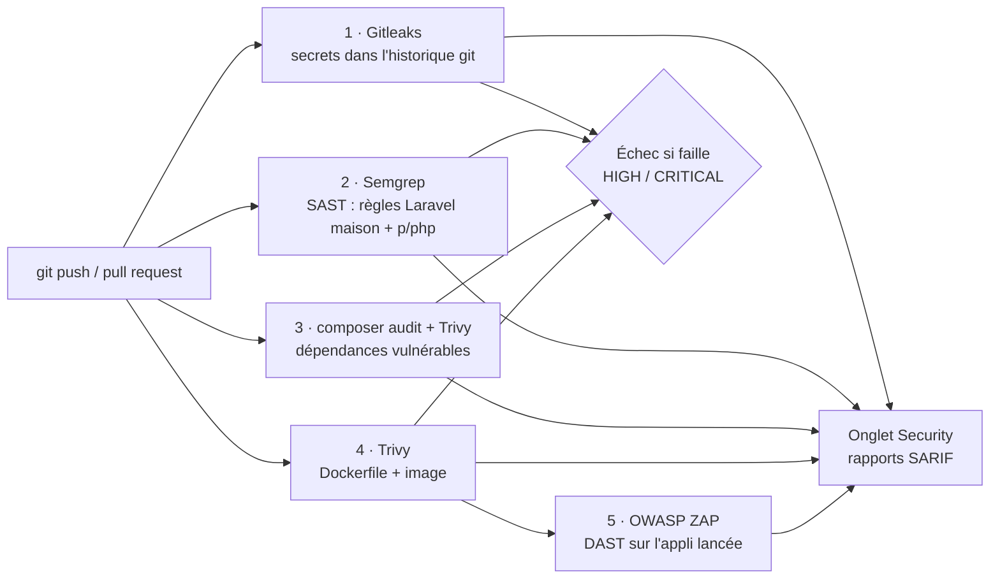

# 🛡️ DevSecOps Laravel Pipeline


Application Laravel **volontairement vulnérable** (« TechShop ») et **pipeline CI/CD DevSecOps** sous GitHub Actions
qui détecte automatiquement ses failles à chaque `push` : secrets, code, dépendances, conteneur et application en fonctionnement.

> 🔴 **Un pipeline rouge est ici le résultat attendu** : il prouve que chaque faille est bien détectée et bloquée.
> La phase 2 (remédiation) le fait passer au vert ; la version vulnérable reste disponible sur la branche `vulnerable`.

> ⚠️ **Projet pédagogique.** L'application contient des vulnérabilités réelles. Ne jamais la déployer sur un serveur accessible.
> Tous les secrets du dépôt sont **factices** et générés aléatoirement.

---

## Architecture du pipeline



| Étape | Outil | Type d'analyse | Ce qui est contrôlé |
|---|---|---|---|
| 1 | **Gitleaks** | Détection de secrets | Tout l'historique git (un secret supprimé reste dans les anciens commits) |
| 2 | **Semgrep** | SAST (analyse statique) | 5 règles Laravel écrites pour ce projet + règles communautaires PHP |
| 3 | **composer audit** + **Trivy fs** | SCA (dépendances) | `composer.lock` comparé aux bases d'avis de sécurité (CVE) |
| 4 | **Trivy config / image** | Sécurité du conteneur | Mauvaises configurations du Dockerfile, CVE des paquets de l'image |
| 5 | **OWASP ZAP** | DAST (analyse dynamique) | Scan passif de l'application démarrée dans le conteneur |

## Vulnérabilités volontaires et détection

| ID | Vulnérabilité | Emplacement | Détectée par |
|---|---|---|---|
| VULN-01 | Injection SQL (concaténation dans `DB::select`) | `app/Http/Controllers/ShopController.php` | Semgrep (règle maison) |
| VULN-02 | XSS réfléchi (`{!! $q !!}` dans Blade) | `resources/views/shop/search.blade.php` | Semgrep (règle maison), ZAP |
| VULN-03 | Fichier `.env` commité avec des secrets | `.env`, `.gitignore` | Gitleaks |
| VULN-04 | `APP_DEBUG=true` en production | `.env` | Semgrep (règle maison) |
| VULN-05 | Secrets exposés côté client | `public/js/app-config.js` | Gitleaks, Semgrep (règle maison) |
| VULN-06 | Path traversal (`/download?file=../../.env`) | `ShopController::download` | Semgrep (règle maison) |
| VULN-07 | Framework vulnérable : `laravel/framework 10.48.22` → **CVE-2024-52301** (manipulation de l'environnement via query string, CVSS 8.7) | `composer.json` | composer audit, Trivy |
| VULN-08 | Conteneur exécuté en `root`, image de base non minimale | `Dockerfile` | Trivy |

### Règles Semgrep écrites pour ce projet

Le dossier [`.semgrep/`](.semgrep/laravel-rules.yml) contient 5 règles spécifiques à Laravel (SQLi sur requêtes brutes,
path traversal, sortie Blade non échappée, mode debug, secrets côté front). Elles ont été testées pour **détecter les 7 occurrences**
du code vulnérable et **ne rien signaler** sur la version corrigée (pas de faux positifs).

## Sécuriser le pipeline lui-même

Un outil de sécurité peut lui aussi être une porte d'entrée : en **mars 2026**, la GitHub Action `trivy-action` a été compromise
(CVE-2026-33634) — 76 tags de version ont été réécrits pour voler les secrets des pipelines qui l'utilisaient. Ce dépôt applique donc :

- **Actions GitHub épinglées sur un SHA de commit** (immuable) plutôt que sur un tag modifiable ;
- **Binaires des scanners en version fixe, vérifiés par empreinte SHA-256** avant exécution (Trivy 0.69.3, version antérieure à la version compromise) ;
- **Permissions minimales** du `GITHUB_TOKEN` (`contents: read`, `security-events: write` uniquement là où c'est nécessaire).

## Lancer le projet en local

Prérequis : Docker.

```bash
docker build -t techshop .
docker run --rm -p 8000:8000 techshop
# puis ouvrir http://localhost:8000
```

Exemples à tester (uniquement en local) :

```text
http://localhost:8000/search?q=<script>alert(1)</script>          -> XSS réfléchi
http://localhost:8000/search?q=' UNION SELECT id, email, password FROM users --   -> injection SQL
http://localhost:8000/download?file=../../.env                     -> path traversal
http://localhost:8000/?--env=local                                 -> CVE-2024-52301 (si register_argc_argv=On)
```

## Phase 2 — Remédiation (en cours)

Objectif : faire passer le pipeline **au vert** via une pull request de correction, faille par faille :

- [ ] VULN-01 : requête préparée (`DB::select('... LIKE ?', ["%{$q}%"])`) ou Eloquent
- [ ] VULN-02 : `{{ $q }}` au lieu de `{!! $q !!}`
- [ ] VULN-03 / 05 : sortir les secrets du dépôt, **les révoquer et les régénérer** (les supprimer ne suffit pas : ils restent dans l'historique git), puis documenter les anciennes empreintes dans `.gitleaksignore`
- [ ] VULN-04 : `APP_DEBUG=false`
- [ ] VULN-06 : `basename()` + liste blanche de fichiers autorisés, `Storage::disk('public')->download()`
- [ ] VULN-07 : mettre à jour `laravel/framework` (≥ 10.48.23)
- [ ] VULN-08 : utilisateur non-root (`USER www-data`), image de base plus légère

## Motivation

Ce projet est né d'une observation de terrain : lors d'un test d'intrusion réalisé en stage, j'ai trouvé des clés d'API
et un accès à un bucket S3 exposés en clair dans le code front-end d'une application en production — exactement le type
d'erreur qu'un pipeline comme celui-ci bloque avant la mise en ligne.

## Stack

Laravel 10 · PHP 8.2 · SQLite · Docker · GitHub Actions · Gitleaks · Semgrep · composer audit · Trivy · OWASP ZAP · SARIF / GitHub Code Scanning
